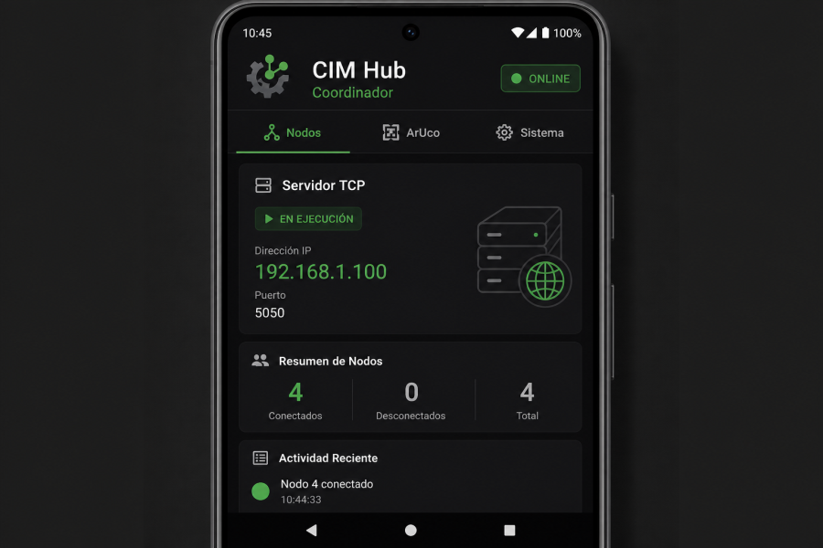
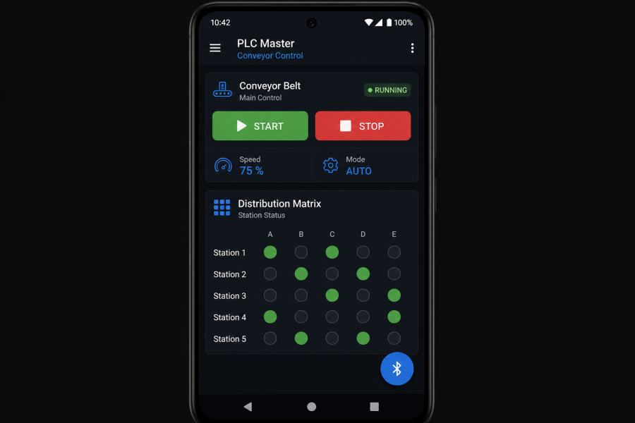
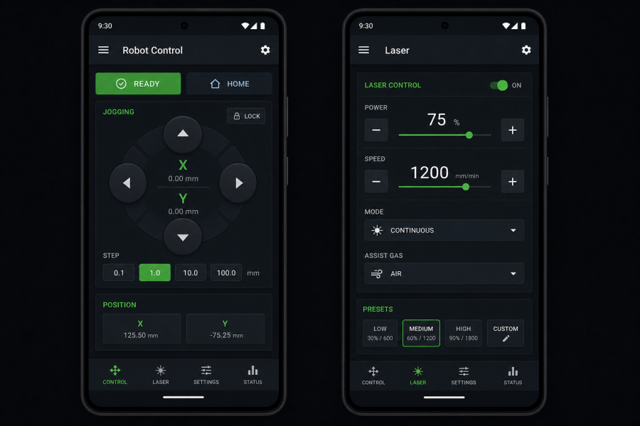
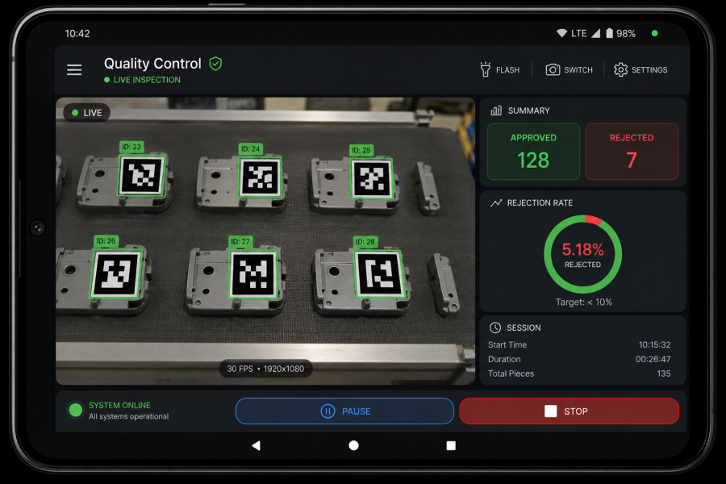

<p align="center">
  
</p>

<h1 align="center">CIM — Plataforma de Integración de Celda Industrial</h1>

<p align="center">
  <a href="https://github.com/LeoAra03/CIM-DEFINITIVO/actions/workflows/ci.yml"></a>
  
  
  
  
</p>

<p align="center">
  Proyecto de titulación · Ingeniería Civil en Informática

  Universidad del Bío-Bío · <strong>Leonardo Araya</strong>
</p>

---

CIM es una plataforma de automatización industrial multiestación: un
coordinador Android, hasta cinco aplicaciones Android de estación, cuatro
firmware ESP32 y un núcleo de comunicación JVM compartido. El laboratorio
simula control PLC, manufactura robótica, inspección por visión y
almacenamiento en racks dentro de una celda coordinada.

El repositorio también documenta el plan de pruebas simulado, el flujo de
manufactura sobre ESP32, los controles de riesgo, la evidencia de auditoría y
la hoja de ruta de implementación.

> **Alcance.** Todo el hardware es simulado salvo los ESP32. La celda no se
> energiza con actuadores reales; las compuertas de seguridad están descritas en
> [docs/SAFETY.md](docs/SAFETY.md) y todavía no validadas en planta.

## Índice

- [Arquitectura](docs/ARCHITECTURE.md)
- [Protocolo CIM](docs/PROTOCOL.md)
- [Pruebas y simulación](docs/TESTING.md)
- [Hardware](docs/HARDWARE.md)
- [Seguridad](docs/SAFETY.md)
- [Gestión de riesgos](docs/RISK.md)
- [Auditoría](docs/AUDIT.md)
- [Estado](docs/REPORT.md)
- [Hoja de ruta](docs/ROADMAP.md)
- [Registro de decisiones](docs/decisions/README.md)

## Estructura del repositorio

- `android/` — Android applications and the `core-network` communication
  library.
- `firmware/` — ESP32 sketches for the PLC master, robot station, vision
  node, and rack node.
- `docs/` — architecture, protocol, testing, hardware, safety, audit, and
  roadmap documentation.
- `tools/` — Python validation, export, and simulation utilities.
- `config/` — Gradle wrapper, version catalog, shared build logic, and
  convention plugins.
- `scripts/` — layout migration and history rewrite helpers.
- `.github/` — continuous integration, issue, and pull request templates.
- `web-preview/` — static reference preview of the coordinator experience.

## Android modules

| Módulo | Paquete | Propósito |
| --- | --- | --- |
| `app-coordinador` | `com.industria.coordinacion` | Concentrador, panel de control, autorización y orquestación BLE/TCP |
| `app-plc` | `com.industria.plc` | Estación de retransmisión PLC, registro local de eventos y parada de emergencia |
| `app-manufactura` | `com.industria.manufactura` | Ciclo de vida del robot, secuencia de manufactura y traspaso al operador |
| `app-calidad` | `com.industria.calidad` | Visión, validación de pallets, inspección ARUCO y código G |
| `app-almacen` | `com.industria.almacenamiento` | Ingreso de pallets, almacenamiento y verificación de posición en racks |
| `wear-coordinador` | `com.industria.wear` | Interfaz de emergencia para Wear OS |
| `core-network` | `com.industria.prefecto` | Comunicación compartida y lógica de dominio |

All applications depend on `core-network`. The coordinator is the TCP hub on
port `8888`; every station connects as a client and identifies itself with a
stable CIM UUID.

## Capturas de interfaz

### Coordinator



### PLC station



### Manufacturing station



### Quality station



## Local validation

Use Python 3.10 or newer:

```bash
python3 tools/validate_system.py
python3 tools/validate_firmware_contract.py
python3 tools/validate_security.py
python3 tools/prehardware_readiness.py
```

Use the Gradle wrapper from `config/`:

```bash
cd config
./gradlew testAllModules detekt ktlintCheck
./gradlew validateApks
./gradlew writeApkChecksums
```

The Python gates validate the repository structure, firmware command
contract, signing posture, and pre-hardware readiness. The Gradle tasks run
JVM unit tests, static analysis, APK builds, and APK checksum generation.
The full continuous integration workflow is defined in
`.github/workflows/ci.yml`.

## Documentation map

- [Architecture](docs/ARCHITECTURE.md)
- [CIM protocol](docs/PROTOCOL.md)
- [Testing and simulation](docs/TESTING.md)
- [Hardware](docs/HARDWARE.md)
- [Safety](docs/SAFETY.md)
- [Risk management](docs/RISK.md)
- [Audit and engineering evidence](docs/AUDIT.md)
- [Status report](docs/REPORT.md)
- [Presentation overview](docs/PRESENTATION.md)
- [Roadmap](docs/ROADMAP.md)
- [Decision log](docs/decisions/README.md)

## Build and release notes

- Android Studio and a local Java 17 toolchain are required for Gradle work.
- APK signing is configured from `config/release.properties` and the
  `CIM_RELEASE_STORE_PASSWORD` environment variable when present.
- Release versioning is `6.0.0`, with Android version code `600`.
- `web-preview/` is a static reference and does not replace the Android
  applications.

## Autoría

Trabajo desarrollado por Leonardo Araya para optar al título de Ingeniería Civil
en Informática de la Universidad del Bío-Bío. La asistencia de herramientas de IA
en la implementación está documentada en [docs/AUDIT.md](docs/AUDIT.md).

## Licencia

Distribuido bajo la Licencia MIT. Consulta [LICENSE](LICENSE).
